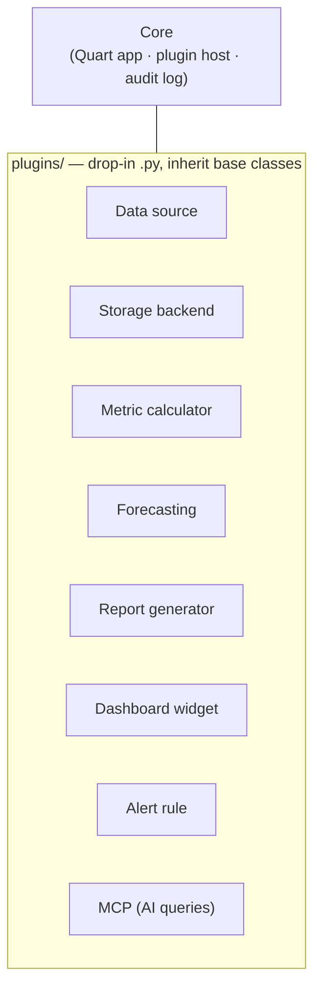

# Architecture

!!! warning "Design in progress"
    The dashboard is in requirements-gathering → design. The stack and plugin
    model below are confirmed; finance-specific details are open questions that
    require a finance stakeholder (see [below](#open-questions)).

## Stack

| Layer | Choice |
|-------|--------|
| Language | Python |
| Web framework | Quart (async) |
| Templating | Jinja2 |
| Frontend | Bootstrap 5, plugin-extensible left nav, responsive (desktop-priority) |
| Packaging | `uv` + `pyproject.toml` (exact-pinned deps) |
| Storage | Plugin — SQLite default, PostgreSQL optional |
| Deployment | ASF Ubuntu LTS · systemd · Apache httpd reverse proxy |
| Auth | HTTP basic auth initially; ASF LDAP eventually |
| Logging | Structured JSON logs; audit trail for all mutating actions |

## Plugin model

The **core must be extensible without modification** — new capability arrives as
drop-in `.py` files in `plugins/` that inherit base classes.

| Plugin type | Role | Default shipped |
|-------------|------|-----------------|
| Data source | Pull financial data (CSV, DB, API) | — |
| Storage backend | Persist data | SQLite |
| Metric calculator | Derived metrics (runway, burn rate) | — |
| Forecasting | Projections | linear runway projection |
| Report generator | PDF / CSV exports | — |
| Dashboard widget | Custom charts/tables | — |
| Alert rule | Threshold / anomaly triggers | — |
| MCP | AI query interface | ✅ shipped by default |

## Financial scope (known)

- **~$4M total:** ~$2M **restricted reserve** (must not be spent) + ~$2M
  **operating cash** (liquid).
- Committee-level budgets (queryable/configurable).
- Revenue tracking includes a **shadow budget** for in-kind donation value.
- Fiscal year configurable (actual start date unknown).

## Open questions

These require a finance stakeholder and must **not** be invented:

- Accounting system in use and how data is extracted.
- ASF fiscal-year start date.
- Full cost/revenue category taxonomies.
- Alert thresholds and delivery.
- Essential metrics per user persona.
- Budget input/approval workflow.
- Existing reports to replicate.
