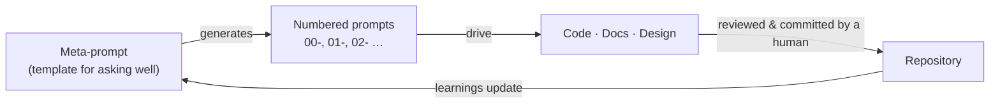

# Prompt System

Development is driven by prompts organized in two layers. The full, binding
description is in the [AI Contribution Guide](ai-contribution.md); this page is
the overview.

## Layer 1 — the meta-prompt

`prompts/asf-financial-dashboard-requirements.md` is a **template that generates
prompts**, not a prompt that builds code. It encodes what we know (architecture,
constraints, financial structure, stakeholders) plus a reusable structure for
producing specific, grounded prompts.

The refinement loop: **generate → review with the lead → refine → use → capture →
synthesize → iterate.** It produces both requirements-gathering prompts (which
feed design) and build prompts (which feed implementation).

## Layer 2 — numbered prompts

Concrete, ordered instructions named `NN-short-kebab-slug.md`, where `NN` is the
zero-padded execution order. `00` is the shared context baseline.

| Range | Theme |
|-------|-------|
| `00`      | Context / baseline |
| `01–09`   | Requirements & design |
| `10–29`   | Core application & plugin framework |
| `30–59`   | Plugins |
| `60–79`   | UI / dashboard |
| `80–89`   | Testing, CI, deployment |
| `90–99`   | Docs, polish, release |

Each prompt carries front-matter (`id`, `status`, `depends_on`, `produces`,
`model`, `provenance`) and a body of **Goal / Inputs / Tasks / Outputs /
Verification / Provenance notes**. Lifecycle: `draft → ready → executed`, or
`superseded` (never deleted — history is the audit trail).

!!! note "We are not pre-authoring the build prompts"
    Only the context baseline (`prompts/00-context.md`) exists today. Numbered
    build prompts are created as the work reaches them, each reviewed and
    refined before execution. The index in
    [`prompts/README.md`](https://github.com/dfoulks1/finance-dashboard/blob/main/prompts/README.md)
    tracks them as they appear.
