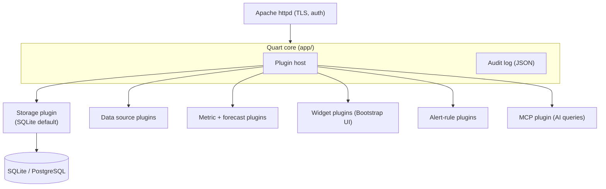

# Software Map

A living map of the repository and the planned component layout. Update it as
structure lands — it is the orientation page for anyone (human or AI) starting
work here.

## Repository layout (today)

```text
finance-dashboard/
├── CONTRIBUTING.md                 # AI contribution guide (authoritative)
├── README.md                       # project entry point
├── mkdocs.yml                      # docs site config (custom Bootstrap 5 theme)
├── theme/                          # custom MkDocs theme (Jinja2 + Bootstrap 5)
│   ├── main.html                   # page template
│   ├── 404.html
│   ├── partials/navbar.html        # central navbar (imported by both templates)
│   └── css/{custom,pygments}.css
├── docs-src/                       # this website's SOURCE (markdown)
│   ├── index.md
│   ├── ai-contribution.md          # embeds CONTRIBUTING.md
│   ├── prompt-system.md
│   ├── architecture.md
│   ├── software-map.md             # ← you are here
│   ├── sbom.md
│   ├── progress.md
│   ├── policy-compliance.md
│   └── requirements.txt            # docs toolchain deps
├── docs/                           # BUILT HTML — served by GitHub Pages (/docs)
├── prompts/                        # prompt library (see CONTRIBUTING §4–5)
│   ├── README.md                   # prompt index
│   ├── 00-context.md               # shared baseline
│   └── asf-financial-dashboard-requirements.md   # the meta-prompt
└── build-docs.sh                   # builds docs-src/ into docs/ locally (no CI)
```

!!! note "Source vs. built output"
    Edit markdown in `docs-src/`. Run `./build-docs.sh` to regenerate `docs/`.
    GitHub Pages serves `docs/` straight from the `main` branch — commit the
    rebuilt `docs/` alongside your source change. No GitHub Actions run.

## Planned application structure

Not yet built — this is the target the numbered prompts will produce.

```text
finance-dashboard/
├── app/                            # Quart application (core)
│   ├── __init__.py                 # app factory, plugin host wiring
│   ├── plugins_api/                # base classes plugins inherit from
│   ├── audit/                      # structured JSON audit log
│   └── templates/                  # Jinja2 + Bootstrap 5
├── plugins/                        # drop-in .py plugins (extend without core edits)
│   ├── storage_sqlite/             # default storage backend
│   ├── forecast_linear/            # default runway projection
│   └── mcp/                        # default AI-query interface
├── tests/
└── pyproject.toml                  # uv-managed, exact-pinned deps
```

## Component map



See [Architecture](architecture.md) for the plugin contract details and
[SBOM](sbom.md) for the dependency inventory.
